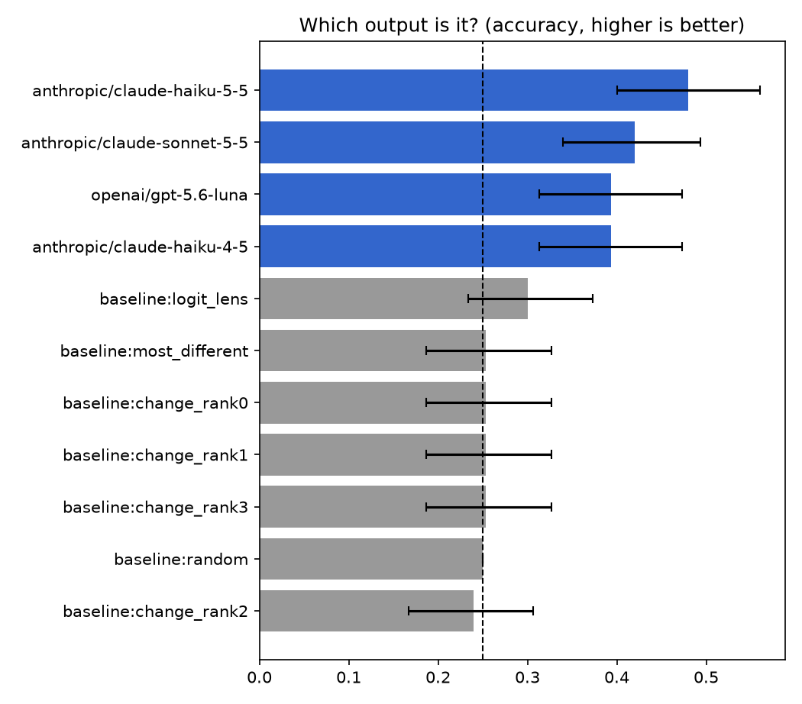

# NeuronBench

<!-- OVERVIEW: one paragraph, written by a team member (hackathon rule: this paragraph must be human-written). -->
Inspired by the new perspective of "neurons are already clean," we analyze if current LLMs are able to determine the impact of a neuron-level intervention on Qwen3-0.6B when given the logit-lens output of the neuron as a hint. We find that interestingly, every model guesses which output was steered better than random chance, but they do not consistently beat even a naive shortcut baseline. On determining whether a steered direction was influential, no model was able to beat chance. One failure mode is that models overindexed on sharpness of the logit lens, which was mostly uncorrelated with the ground truth.

## What it measures

Each task gives an agent the address of one MLP neuron in a small LLM (Qwen3-0.6B by default), static evidence
about it, and a concrete intervention, then asks for a checkable prediction. Ground truth is what actually happened
when we ran the intervention with [gguf-neuron-explorer](https://github.com/balaena01/gguf-neuron-explorer) (`gne`), compared against random
directions of the same size.

| Task | The agent sees | It answers | Scored by | Chance |
|---|---|---|---|---|
| **Which output is it?** (`choice-*`) | evidence, a prompt, the unsteered reply, four replies at the same dose: one from pushing the neuron, three from pushing random directions of exactly the same length | A, B, C or D | accuracy | 0.25 |
| **Real or null?** (`null-*`) | evidence, the sweep protocol, the unsteered replies | P(the neuron's effect beats ≥ 95% of random controls) | Brier score | 0.25 at p = 0.5 |

**Evidence only.** The agent gets static facts computed from the weights and from unsteered activations
(`down_norm`, logit lens top/bottom tokens and `peak_z`, activation statistics, cosine with named directions). Anything
measured from pushing the neuron (`sweep`, `steer_lens`, `evals`, names) is dropped by
[`neuronbench/evidence.py`](neuronbench/evidence.py). The model has no tools to run interventions and no answer key in
its container: the verifier runs in a separate container and only receives `/app/answer.txt`.

**Controls against shortcuts.**
- Distractors are random-direction pushes at the same dose on the same prompt. They are sampled from the controls whose
  distance from the unsteered reply is within 0.15 of the real reply's. So "pick the most broken reply" doesn't work,
  and neither does "pick the middle one". The `most_different` and `change_rank0..3` baselines check this.
- Choice items skip the design's deliberate "break it" dose (|dose| > 1.6) and replies that barely changed.
- Null items are about half REAL and half NULL; NULLs include near-misses (`null_pct` 0.5–0.95) and clear nulls.
- `evidence_logreg` fits a cross-validated logistic regression on the numeric evidence fields. If it does well, the
  evidence leaks the label.
- Items are stratified by effect size (gne `rank` vocabulary mass), and results are reported per quartile.
- The `logit_lens` baseline is the obvious non-AI reading of the evidence: pick the reply that gained the most
  logit-lens tokens on the side the dose pushes toward ("up" for a positive dose, "down" for a negative one).
  `scripts/ceiling_baselines.py` tries stronger variants (fuzzy subword matching, script matching, a cross-validated
  learned scorer over text features); none beats it by more than a point.

## Layout

```
neuronbench/       gne_io (read sweeps), evidence (sanitise), items (build items), harbor_tasks (write tasks),
                   baselines, results (collect Harbor jobs, tables, plots), cli
dataset/metric.py  Harbor dataset metric: accuracy and Brier score with bootstrap 95% CIs
scripts/export_evidence.py   run next to gne to dump per-neuron evidence
modal/serve_vllm.py          open-weight models as OpenAI-compatible endpoints on Modal
tests/             pytest on a synthetic sweep
```

## 1. Ground truth (on the machine with gne and the model)

```bash
export GNE_MODEL=models/Qwen3-0.6B-Q8_0.gguf
gne verify                                   # once per model/backend
gne stats resid
gne stats act                                # optional: activation statistics in the evidence
for L in 6 14 20 24; do
  gne lens logit --layer $L
  gne sweep --layer $L                       # 384 random neurons + 64 random controls, design main_rel
  gne sweep --layer $L --neurons <ids>       # optional extras: e.g. the 64 sharpest logit-lens neurons (more REAL items)
  gne rank --run L$L-main_rel
done
python scripts/export_evidence.py --model $GNE_MODEL --run ~/.gne/runs/<model_id>/L*-main_rel.jsonl --out data/evidence
```

Copy `~/.gne/runs/<model_id>/L*-main_rel.{jsonl,meta.json,units.jsonl}` (and any `.part-*.jsonl`) to `data/raw/`.

## 2. Build tasks

```bash
uv venv -p 3.12 && uv pip install -e '.[dev,plots]'
neuronbench build --run data/raw/L*-main_rel.jsonl --evidence data/evidence \
    --n-choice 30 --n-null 20 --items data/items.jsonl --out tasks
neuronbench baselines --items data/items.jsonl
harbor lint tasks/*/
harbor run -p tasks -a oracle                # every reward should be 1
```

`--n-choice` / `--n-null` are per layer, so 4 layers × (30 + 20) = 200 items. `data/items.jsonl` holds the hidden
answer and diagnostics for every item and is what the baselines and report read. Each item's `meta.selection` says
whether its neuron came from gne's seeded `random:384` draw or was hand-picked (extras), so results can be split.

`tasks/` holds task folders only. Valkyrie rejects a dataset that contains `metric.py`, so `dataset/metric.py` stays
out of it. Use it for plain Harbor datasets, or run it on exported rewards.

### More prompts (choice)

The main sweep has only three task prompts, and per-prompt accuracy varied more than the gap between models. A
top-up sweep runs 100 neurons per layer (from the seeded `random:384` draw, stratified by `null_pct`; lists in
`extra_prompts/`) and the same 64 random controls on ten more prompts at doses -0.7 and +0.8
([`extra_prompts/design.yaml`](extra_prompts/design.yaml)). `--per-neuron 3` puts each neuron's three questions on
different prompts and balances the prompts (30 questions each per layer). These sweeps ran on CPU (llama.cpp, same
GGUF and gne model id); all four options in a question come from the same sweep, so CPU-vs-Metal numerics never mix
within a question.

```bash
python scripts/prompts_configs.py && export GNE_CONFIGS=$PWD/extra_prompts/gne-configs
for L in 14 20 24; do                        # the design keeps its first name, heldout_rel
  gne --n-seq-max 10 sweep --layer $L --design heldout_rel --prompt-set heldout \
      --neurons "$(cat extra_prompts/neurons-L$L-full.txt)" --yes
  gne rank --run L$L-heldout_rel
  neuronbench build --run data/raw/L$L-heldout_rel.jsonl --evidence data/evidence --n-choice 100 --n-null 0 \
      --per-neuron 3 --items data/items-prompts-L$L.jsonl --out tasks-prompts-l$L
done
cat data/items-prompts-L{14,20,24}.jsonl > data/items-prompts.jsonl     # 900 choice items
```

## 3. Run models

Same agent (mini-SWE-agent), prompts and limits for every model.

**Why mini-SWE-agent.** The task is reasoning over a few text files, not software engineering, so the harness should
add as little as possible. mini-SWE-agent is a bash-only loop with no custom tools, scaffolding or system-prompt tricks.
That keeps the comparison about the model. It runs any litellm model (Anthropic, OpenAI and self-hosted vLLM) with
identical prompts and step/cost limits. Its trajectories are plain message logs, so the failure modes below can be
quoted directly. Claude Code and Codex would bring vendor-specific tooling and prompts, so cross-vendor differences
would partly measure the harness. The container has no intervention tools and no answer key, and its network allows
only the model API hosts (`api.anthropic.com`, `api.openai.com`).


```bash
harbor run -p tasks -a mini-swe-agent -m anthropic/<model> -n 8 -o jobs --job-name <model>
harbor run -p tasks -a mini-swe-agent -m openai/<model>    -n 8 -o jobs --job-name <model>
```

**On Valkyrie** (the hackathon's hosted Harbor; sandboxes on Modal). The dataset must not contain `metric.py`,
and `allowed_hosts` must be exact hostnames. Model keys and base URLs are Valkyrie secrets passed as env vars:

```bash
valkyrie dataset push neuronbench/l14-l20 ./tasks   # we pushed tasks for L14+L20 and L24 as two datasets
valkyrie run start --agent mini_swe_agent --dataset neuronbench/l14-l20@1 \
    --model anthropic/claude-haiku-4-5 --provider modal -s ANTHROPIC_API_KEY anthropic-api-key \
    --concurrency 8 --label haiku-4-5 --connect
# self-hosted vLLM endpoint (its hostname must be in --allowed-hosts at build time). The mini_swe_agent contract
# has no base-URL kwarg, so litellm's hosted_vllm provider reads the endpoint from env vars.
valkyrie run start --agent mini_swe_agent --dataset neuronbench/l14-l20@1 \
    --model hosted_vllm/Qwen/Qwen3-32B --provider modal \
    -s HOSTED_VLLM_API_BASE vllm-base-url-qwen3-32b -s HOSTED_VLLM_API_KEY vllm-api-key \
    -k cost_tracking ignore_errors --concurrency 8 --label qwen3-32b --connect
valkyrie run results <run-id> --path jobs/<label>.json     # neuronbench report reads these too
```

**Open-weight models on Modal.**

```bash
modal secret create neuronbench-vllm VLLM_API_KEY=$(openssl rand -hex 16)
MODEL=openai/gpt-oss-120b GPU=H200 modal deploy modal/serve_vllm.py
MODEL=Qwen/Qwen3-32B      GPU=H200 modal deploy modal/serve_vllm.py
MODEL=Qwen/Qwen3-0.6B     GPU=L4   modal deploy modal/serve_vllm.py
harbor run -p tasks -a mini-swe-agent -m openai/Qwen/Qwen3-32B \
    --base-url https://<workspace>--nb-vllm-qwen3-32b-serve.modal.run/v1 \
    --ae MSWEA_API_KEY=$VLLM_API_KEY -n 8 -o jobs --job-name qwen3-32b
```

The agent runs inside the task container, so the container must reach the model API. By default tasks use
`network_mode = "allowlist"` with `allowed_hosts = ["api.anthropic.com", "api.openai.com"]`. For a Modal endpoint, add its
exact hostname:
`neuronbench build ... --allowed-hosts api.anthropic.com,api.openai.com,<workspace>--nb-vllm-qwen3-32b-serve.modal.run`.
`--allowed-hosts ""` gives unrestricted network.

## 4. Report

```bash
neuronbench report --items data/items.jsonl --jobs jobs/* --out results
```

This writes `results/results.md` (each system with a 95% bootstrap CI, baselines included), `results/results_by_selection.md`
(the same split by random-draw vs hand-picked neurons), `results/results.json`,
and plots: `choice_accuracy.png`, `null_brier.png` and `choice_by_effect_size.png`. A model only beats the
baselines if its interval clears the best baseline's.

Harbor's own end-of-run table averages each reward key over all trials, including trials of the other task type,
which halves both numbers. Use `neuronbench report`, or the dataset `metric.py`, for the real figures.

## Results

Qwen3-0.6B Q8_0, layers 14, 20 and 24: 255 tasks (150 "Which output is it?", 105 "Real or null?" with 54 real).
Seven models ran as mini-SWE-agent on Valkyrie (five API models, plus Qwen3-32B and Qwen3-0.6B self-hosted on Modal
vLLM) and were scored offline
(`neuronbench report --items data/items.jsonl --jobs jobs/valkyrie/*.json --out results`). Long form with every
number: [`results/analysis.md`](results/analysis.md); datasets and run IDs: [`results/runs.md`](results/runs.md).

| system | Which output is it? accuracy [95% CI] | Real or null? Brier (AUC) |
|---|---|---|
| Claude Haiku 5.5 | **0.48** [0.40, 0.56] | 0.255 (0.56) |
| Claude Opus 5.5 | 0.45 [0.37, 0.53] | **0.245** (0.61) |
| Claude Sonnet 5.5 | 0.42 [0.34, 0.49] | 0.247 (0.57) |
| GPT-5.6-luna | 0.39 [0.31, 0.47] | 0.308 (0.54) |
| Claude Haiku 4.5 | 0.39 [0.31, 0.47] | 0.294 (0.52) |
| Qwen3-32B, self-hosted\* | 0.39 [0.32, 0.47] | 0.392 (0.46) |
| Qwen3-0.6B, self-hosted\* | 0.23 [0.17, 0.31] | 0.385 (0.49) |
| best shortcut: logit-lens lookup, dose-sign aware | 0.41 [0.33, 0.49] | |
| best shortcut: base rate / evidence logreg | | 0.255 / 0.255 |
| chance | 0.25 | 0.25 (0.50) |
| *ceiling:* Haiku 5.5 given the neuron's measured sweep words | 0.63 [0.55, 0.71] | 0.210 (0.78) |
| *ceiling:* Sonnet 5.5, same | 0.71 [0.64, 0.79] | 0.189 (0.83) |

\* The Qwen3 models rarely run the submit command: they write an answer early, keep rewriting `answer.txt` until the
600 s agent limit, and are graded on the file at that point (timeouts: Qwen3-32B 139/150 choice and 8/105 null tasks,
Qwen3-0.6B 63/150 and 43/105). No API-model task failed or timed out.

Intervals are 95% percentile bootstraps over items (2,000 resamples). Each model ran each task once, so they cover
item sampling, not run-to-run variation. Every system answered the same 150 choice items, so the choice intervals are
all about ±8 points; null-task intervals are narrow for models that hedge near 0.5 and wide for confident ones. Use
the paired comparisons below for head-to-head claims.

Random-draw vs hand-picked neurons ([`results/results_by_selection.md`](results/results_by_selection.md)); picked
neurons were chosen for a sharp logit lens, and with 16 picked choice and 20 picked null items no gap is significant:

| system | choice: picked (16) / random (134) | null Brier: picked (20) / random (85) |
|---|---|---|
| Claude Haiku 5.5 | 0.31 / 0.50 | 0.246 / 0.257 |
| Claude Opus 5.5 | 0.44 / 0.45 | 0.220 / 0.250 |
| Claude Sonnet 5.5 | 0.38 / 0.43 | 0.245 / 0.247 |
| GPT-5.6-luna | 0.44 / 0.39 | 0.282 / 0.314 |
| Claude Haiku 4.5 | 0.56 / 0.37 | 0.263 / 0.301 |
| Qwen3-32B\* | 0.50 / 0.38 | 0.354 / 0.401 |
| Qwen3-0.6B\* | 0.31 / 0.22 | 0.340 / 0.395 |
| logit-lens lookup / base rate | 0.56 / 0.39 | 0.252 / 0.255 |




**Six findings.**

1. **No model clearly beats a word lookup.** Picking the reply that gained the most logit-lens tokens on the side
   the dose pushes scores 41%. Haiku 5.5 is +7 points above it (paired 95% CI [−3, +18]) and Opus 5.5 +4; the other
   API models are at or below it. Accuracy is not ordered by model size. Open-weight Qwen3-32B ties GPT-5.6-luna and
   Haiku 4.5 (39%); Qwen3-0.6B, the steered model itself, is at chance on its own neurons (23%).
2. **The solvable half is the one you can read off the text.** In 50 of 150 items a lens token literally occurs in a
   candidate reply: lookup 64%, API models 52–62%. In the other 100: lookup 29%, API models 32–41%, and only Haiku
   5.5's and Opus 5.5's intervals clear chance. Models don't even apply the lookup consistently: API models agree with
   its pick on 31–35% of items and solve only about half of the 61 items it gets right, so "model or lookup right" reaches 59–67%.
3. **Nobody can tell which neurons matter.** "Real or null?" AUC is 0.52–0.61 for the API models (Opus 5.5 highest) and
   0.46–0.49 for the Qwens. The API models' Brier spread is calibration, not knowledge: replacing each one's answers
   with its own mean changes its Brier by ≤ 0.03. They set their probability from the logit-lens peak z-score
   (Spearman 0.60–0.85), which has Spearman 0.13 with the truth. Opus 5.5 and Sonnet 5.5 "win" by staying near 0.5;
   Haiku 4.5 and GPT-5.6-luna lose by saying 0.7–0.9, and the Qwens by saying "real" to almost everything (mean 0.82–0.88).
4. **The static evidence, not the task format, is the bottleneck.** Rebuilding the same items with the neuron's
   measured over-used words in the evidence (`--tier oracle`) lifts Haiku 5.5 from 48% to 63% (paired +15
   [+5, +25]) and Sonnet 5.5 from 42% to 71%; on the 82 items where those words point at one reply they score 87%
   and 93%. Showing the neuron's steered replies on *other* prompts (`--tier transfer`) adds nothing on choice
   (+0 [−8, +8]) but lifts null AUC from 0.56 to 0.69. The oracle null lookup (Brier 0.089) is not a ceiling: its one
   feature, the summed top z-scores, is the vocabulary mass the label is computed from.
5. **Thinking longer didn't help, and the models fail differently.** Haiku 4.5 (median 6 API calls, $10 run) tied for
   last; Haiku 5.5 (≤ 2 calls on 70% of tasks, $0.27 run) came first. Among the first four API models, pairwise agreement is
   39–65%, 44 items were missed by all four, and a plurality vote (40%) is worse than the best single model.
6. **On choice the models do read the evidence; on null they don't.** Wrong-evidence control (`--tier shuffled`): the
   same 255 items, with each showing another same-layer neuron's static evidence. Choice accuracy falls to chance:
   Haiku 5.5 48% → 21% (paired −27 [−36, −19]) and Opus 5.5 45% → 23% (−22 [−32, −12]), with the lookup at 41% → 26%.
   So the replies alone don't carry the above-chance scores, and wrong evidence misleads the models. The drop holds on
   the 100 items with no lens token in any reply (Haiku 41% → 18%, Opus 39% → 21%), so it isn't only literal token
   matching. Null doesn't move: Brier +0.001 / +0.011 and AUC −0.03 / −0.07, all CIs include 0. Their "Real or null?"
   answers don't depend on which neuron's evidence they see.

**Failure modes**, from the 1020 trajectories of the first four API models (Sonnet 5.5 exposes no reasoning):

- *Oddest reply:* "random directions cause mild drift, so the reply that departs most is the neuron" (Haiku 5.5).
  The distractors are matched on change, so this is chance; every model does it on 28–34% of items.
- *Dose folklore:* "+0.5 should be a subtle slip, so pick the gentlest reply". Haiku 4.5's single worst habit
  (36 items, 81% wrong).
- *Trait invention:* a token list becomes a personality: "this neuron helps the model escape loops" (36 items for
  Haiku 4.5, 69% wrong). Trace below.
- *Subword matching:* counting `-ing`, `e`, `s` across replies (GPT-5.6-luna).
- *On "Real or null?":* logit-lens sharpness or a "coherent token family" taken as proof of causal effect, then either
  overconfidence (Haiku 4.5, GPT) or anchoring on the stated base rate (Sonnet 5.5: 0.4–0.6 on 103 of 105 items).

**Failure trace** (`choice-qwen3-0.6b-instruct-L14-N710-orange-0.7`, Haiku 4.5; transcript in
[`results/failure_trace_L14-N710.md`](results/failure_trace_L14-N710.md)). Layer 14 neuron 710 at dose −0.7 on
"Describe the color orange" is real (beats 64/64 controls); its lens promotes junk tokens (`onium`, `技术和`) and
suppresses role-ish ones (`UserCode`, `Participant`). The real reply was the two-word `The color orange?`. Haiku
first decided the down-tokens look "formal", so a negative dose should make the reply "more organised", then
reversed itself and chose a looping reply because "the neuron normally helps the model escape loops; reversed, it gets
stuck". Nothing in the evidence supports either story; it fitted a reply to a narrative about the neuron. All four
candidates had moved 0.83–0.92 from the unsteered reply, so "the most broken one" was no help, which is what the
random-direction controls are for.
