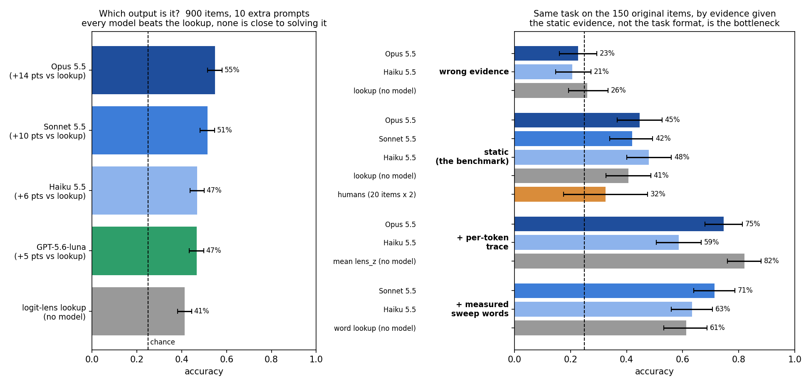
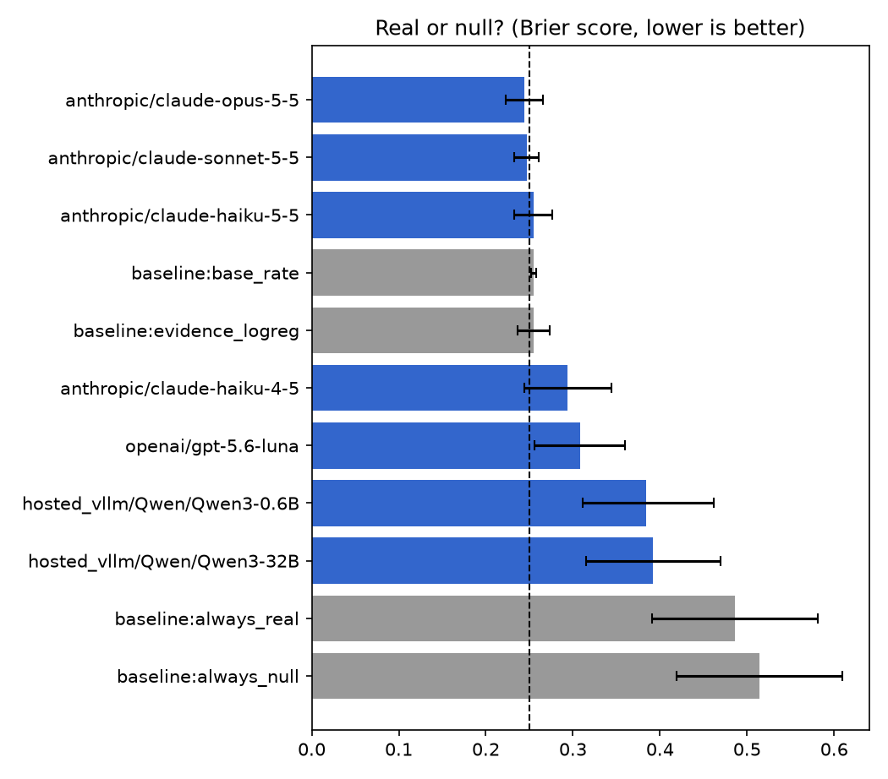

# NeuronBench

<!-- OVERVIEW: one paragraph, written by a team member (hackathon rule: this paragraph must be human-written). -->
Inspired by Goodfire's ["Neural Networks Are Already Clean"](https://already-clean.goodfire.com/) (Cammarata, 2026), we analyze whether current LLMs are able to determine the impact of a neuron-level intervention on Qwen3-0.6B when given the logit-lens output of the neuron as a hint. We design two evals, one to see if models can guess which output came from steering the neuron rather than a random direction of similar size (eval "Which output is it?"), and one to determine whether a neuron's effect is real by beating 95% of random directions' vocabulary mass (eval "Real or null?"). For "Which output is it?," we find that frontier models can guess better than random chance; overall, they beat a simple shortcut baseline, but not by much (best model reaches 55%). On "Real or null?," no model was able to confidently beat chance. Interestingly, models on "Which output is it?" often fail by picking the reply that changed most even though distractors are changed about as much. Also, on "Real or null?," models often overindex the logit lens's sharpness, which was mostly uncorrelated with the ground truth.


## What it measures

Each task gives an agent the address of one MLP neuron in Qwen3-0.6B, static evidence about it, and a concrete
intervention, then asks for a checkable prediction. Ground truth is what actually happened when we ran the
intervention with [gguf-neuron-explorer](https://github.com/balaena01/gguf-neuron-explorer) (`gne`), compared against
random directions of the same size.

| Task | The agent sees | It answers | Scored by | Chance |
|---|---|---|---|---|
| **Which output is it?** (`choice-*`) | evidence, a prompt, the unsteered reply, four replies at the same dose: one from pushing the neuron, three from pushing random directions of exactly the same length | A, B, C or D | accuracy | 0.25 |
| **Real or null?** (`null-*`) | evidence, the sweep protocol, the unsteered replies | P(the neuron's effect beats ≥ 95% of random controls) | Brier score | 0.25 at p = 0.5 |

- **Evidence only.** Static facts from the weights and unsteered activations: `down_norm`, logit-lens top/bottom
  tokens and `peak_z`. Anything measured by pushing the neuron is dropped
  ([`neuronbench/evidence.py`](neuronbench/evidence.py)). The agent has a bash shell but no model, no intervention
  tools and no answer key; the verifier runs in a separate container and only sees `/app/answer.txt`.
- **Distractors are matched on change.** They are random-direction pushes at the same dose on the same prompt, drawn
  from controls whose distance from the unsteered reply is within 0.15 of the real reply's. Picking the most (or
  least, or middle) changed reply scores 24–25%; picking the longest or shortest reply scores 23–25%.
- **Shortcut baselines.** The `logit_lens` lookup is the obvious non-AI reading: pick the reply that gained the most
  lens tokens on the side the dose pushes. Stronger variants (`scripts/ceiling_baselines.py`) add at most a point.
  On "Real or null?", a cross-validated logistic regression on the evidence (`evidence_logreg`) ties the base rate.
- **Evidence tiers.** The same items rebuilt with wrong, richer or per-token evidence (`neuronbench build --tier`)
  test whether scores come from the evidence and where the ceiling is
  ([`results/analysis.md`](results/analysis.md#ceiling-controls-is-it-the-evidence-or-the-task)).

## Two example tasks

Both are "Which output is it?" items from the 900 more-prompts set, shown in brief. The agent sees the full replies;
the full task is in `instruction.md` under the folder named in each heading. "Change" is each reply's distance from the
unsteered reply. The raw records behind items like these (item JSON, the evidence tiers, gne sweeps, task folders)
are in [`docs/sample_data.md`](docs/sample_data.md).

**1. The lens gives it away**
([`tasks-prompts-l24/choice-qwen3-0.6b-instruct-L24-N1344-math-0.7`](tasks-prompts-l24/choice-qwen3-0.6b-instruct-L24-N1344-math-0.7/instruction.md)).
Layer 24 neuron 1344, dose −0.7, prompt "What is 17 times 23? Show your work." Unsteered reply: `17 × 23 = 391`. The
neuron's logit lens suppresses `increase`, `increasing`, `增加`, `Increase`, …, and a negative dose pushes toward those
tokens.

| | reply (start) | change |
|---|---|---|
| A | "To find **17 × 23**, follow these steps: … Multiply 17 by 2 … Add the products: 51 + 34 = 85" | 0.60 |
| **B** ✓ | "To increase your knowledge of increasing and increasing by 2, you can increase each number by 2 and then increase each increase by 2." | 0.75 |
| C | "17 × 23 = (10 + 1) × (20 + 3) = … = 226" | 0.68 |
| D | "Add the numbers: 17 + 23 = 30. Multiply the sum by 23: 30 × 23 = 690" | 0.68 |

All four models and the logit-lens lookup pick B. This is the easy case: a lens token appears in one reply only.

**2. The strangest reply is a trap**
([`tasks-prompts-l24/choice-qwen3-0.6b-instruct-L24-N2714-french-0.7`](tasks-prompts-l24/choice-qwen3-0.6b-instruct-L24-N2714-french-0.7/instruction.md)).
Layer 24 neuron 2714, dose −0.7, prompt "Translate 'Good morning, how are you?' into French and Spanish." Unsteered reply:
`"Bonjour, comment ça va?" "Buenos días, ¿cómo estás?"`. The lens promotes `receive`, `receiving`, `receipt`, `接收`, …,
and a negative dose pushes away from them. No lens token appears in any reply. The neuron's effect is real: it beats
all 64 random controls on vocabulary mass.

| | reply (start) | change |
|---|---|---|
| A | "翻译如下：**法语：Bonjour, bien bien？** **西班牙文：Buenas Toleraciones, cómo estas?** (注意：…)" | 0.70 |
| B | "Bonjour, bien chy? (l'ouverti)" "¡Cómo te lomasi? (l'ouverti)" | 0.55 |
| **C** ✓ | "**French:** Bonjour, comment vous êtes? **Spanish:** Buen día, cómo estás? 😊" | 0.57 |
| D | "« Bon césuite, bien ça c'é요 ? » in French and « Buena mañana, ¿cómo está usted ? » in Spanish." | 0.57 |

All four models pick A, the reply that changed most. Here the real push left a nearly normal translation, while a
random direction of the same length switched the reply to Chinese. "Pick the most broken reply" scores at chance on
this benchmark, and models still fall back on it on 28–34% of the original 150 items (see Failure modes).

## Results



Seven models ran as mini-SWE-agent on Valkyrie, one attempt per task; datasets and run IDs are in
[`results/runs.md`](results/runs.md), the full analysis in [`results/analysis.md`](results/analysis.md). Intervals are
95% bootstraps over items; "vs lookup" is paired over the same items.

**"Which output is it?", 900 items** (100 neurons × 3 prompts per layer, layers 14/20/24, ten prompts; left panel):

| system | accuracy [95% CI] | vs lookup [95% CI] |
|---|---|---|
| Claude Opus 5.5 | **0.55** [0.52, 0.58] | +0.14 [+0.10, +0.18] |
| Claude Sonnet 5.5 | 0.51 [0.48, 0.55] | +0.10 [+0.06, +0.14] |
| Claude Haiku 5.5 | 0.47 [0.44, 0.50] | +0.06 [+0.02, +0.09] |
| GPT-5.6-luna | 0.47 [0.43, 0.50] | +0.05 [+0.02, +0.09] |
| logit-lens lookup (no model) | 0.41 [0.38, 0.44] | |
| chance | 0.25 | |

### Four findings

1. **Given a per-token table, the agents don't do the obvious arithmetic.** The trace tier adds a table under each
   reply with every token's logit-lens z-score for this neuron (`lens_z`, from the weights; nothing from a steered
   run). Averaging that one column per reply, which takes a few lines of code in the agent's own shell, picks the right
   reply 82% of the time with no model. Opus 5.5 reaches 75% (paired −7 [−15, +1]) and Haiku 5.5 59% (−23 [−32, −15]).
   The signal is real: with another neuron's table (`trace-shuffled`) both drop to chance (23% / 21%). The models use
   the table, but do worse than its simplest summary (right panel; 150 original items).
2. **Every model beats the lookup, and none comes close to solving the task.** Opus 5.5 leads (55%) and beats
   Haiku 5.5 by +8 points [+5, +11]. Accuracy rises with layer along with the lookup (Opus 43% / 59% / 63% on
   L14 / L20 / L24), while the margin over the lookup shrinks (only Opus clears 0 at L24). Models add most on
   open-ended text (ocean poem: Opus +28 over the lookup) and least on code and structured answers (SQL query −3 to
   +2). Resampling neurons instead of items leaves every interval within half a point.
3. **Humans are at chance on the static evidence too.** Two people answered the same 20 static items blind
   (`scripts/human_sheet.py make --items data/items.jsonl --n 20 --seed 0`; answers in [`human/`](human/)): 30% and 35%, 32.5% [15, 50]
   pooled. On those 20 items the four newest API models score 35–40% and the lookup 40%, so 20 items can't separate humans from
   models. What is solvable is mostly readable off the text: in 50 of the 150 original items a lens token occurs in
   a candidate reply (lookup 64%, API models 52–62%); in the other 100 the lookup gets 29% and models 32–41%.
4. **Nobody can tell which neurons matter.** "Real or null?" AUC is 0.52–0.61 for the API models and 0.46–0.49 for the
   Qwens. Models set their probability from the logit-lens `peak_z` (Spearman 0.60–0.85), which has Spearman 0.13
   with the truth, and the evidence regression ties the base rate, so this task mostly measures calibration: Opus
   and Sonnet "win" by staying near 0.5; Haiku 4.5 and GPT-5.6-luna lose by saying 0.7–0.9.

### Original 255-item run (all seven models, both tasks)

150 "Which output is it?" items (three prompts) and 105 "Real or null?" items (54 real), layers 14/20/24. On these
150 items no model clearly beats the lookup (Haiku 5.5 +7 [−3, +18]), and the order differs from the 900-item run.

| system | Which output is it? [95% CI] | Real or null? Brier (AUC) |
|---|---|---|
| Claude Haiku 5.5 | **0.48** [0.40, 0.56] | 0.255 (0.56) |
| Claude Opus 5.5 | 0.45 [0.37, 0.53] | **0.245** (0.61) |
| Claude Sonnet 5.5 | 0.42 [0.34, 0.49] | 0.247 (0.57) |
| GPT-5.6-luna | 0.39 [0.31, 0.47] | 0.308 (0.54) |
| Claude Haiku 4.5 | 0.39 [0.31, 0.47] | 0.294 (0.52) |
| Qwen3-32B, self-hosted\* | 0.39 [0.32, 0.47] | 0.392 (0.46) |
| Qwen3-0.6B (the steered model), self-hosted\* | 0.23 [0.17, 0.31] | 0.385 (0.49) |
| logit-lens lookup / base rate / evidence logreg | 0.41 [0.33, 0.49] | 0.255 / 0.255 |
| chance | 0.25 | 0.25 (0.50) |
| humans, 20 items × 2 people | 0.325 [0.150, 0.500] | |
| Sonnet 5.5 with measured sweep words (oracle tier) | 0.71 [0.64, 0.79] | 0.189 (0.83) |

\* The Qwen3 models rarely submit: they keep rewriting `answer.txt` until the 600 s limit and are graded on the file
at that point (Qwen3-32B timed out on 139/150 choice tasks). No API-model task failed or timed out. Split by
random-draw vs hand-picked neurons: [`results/results_by_selection.md`](results/results_by_selection.md).



**Failure modes**, from the 1020 trajectories of the first four API models (Sonnet 5.5 exposes no reasoning):

- *Oddest reply:* "random directions cause mild drift, so the reply that departs most is the neuron" (Haiku 5.5).
  The distractors are matched on change, so this is chance; every model does it on 28–34% of items.
- *Dose folklore:* "+0.5 should be a subtle slip, so pick the gentlest reply". Haiku 4.5's single worst habit
  (36 items, 81% wrong).
- *Trait invention:* a token list becomes a personality: "this neuron helps the model escape loops" (36 items for
  Haiku 4.5, 69% wrong). Trace below.
- *Subword matching:* counting `-ing`, `e`, `s` across replies (GPT-5.6-luna).
- *On "Real or null?":* logit-lens sharpness or a "coherent token family" taken as proof of causal effect, then either
  overconfidence (Haiku 4.5, GPT) or anchoring on the stated base rate (Sonnet 5.5: 0.4–0.6 on 103 of 105 items).

**Failure trace** (`choice-qwen3-0.6b-instruct-L14-N710-orange-0.7`, Haiku 4.5; transcript in
[`results/failure_trace_L14-N710.md`](results/failure_trace_L14-N710.md)). Layer 14 neuron 710 at dose −0.7 on
"Describe the color orange" is real (beats 64/64 controls); its lens promotes junk tokens (`onium`, `技术和`) and
suppresses role-ish ones (`UserCode`, `Participant`). The real reply was the two-word `The color orange?`. Haiku
first decided the down-tokens look "formal", so a negative dose should make the reply "more organised", then
reversed itself and chose a looping reply because "the neuron normally helps the model escape loops; reversed, it gets
stuck". Nothing in the evidence supports either story; it fitted a reply to a narrative about the neuron. All four
candidates had moved 0.83–0.92 from the unsteered reply, so "the most broken one" was no help, which is what the
random-direction controls are for.

## Run it

```
neuronbench/       build items and Harbor tasks, baselines, report (cli: `neuronbench build|baselines|report`)
data/raw/          gne sweeps (slimmed); data/evidence/ per-neuron static evidence; data/items*.jsonl items + keys
tasks/             255 Harbor tasks (static tier); tasks-prompts-l{14,20,24}/ the 900 more-prompts tasks
jobs/valkyrie/     every Valkyrie run export behind the results
docs/              reproduce.md (full pipeline), sample_data.md (example records from every data file)
```

The built tasks are committed. **Why mini-SWE-agent:** the task is reasoning over a few text files, so the harness
should add as little as possible; a bash-only loop with no custom tools runs every model (Anthropic, OpenAI,
self-hosted vLLM) with identical prompts and limits, so cross-vendor differences measure the model, not the harness.

```bash
uv venv -p 3.12 && uv pip install -e '.[dev,plots]'
harbor run -p tasks -a mini-swe-agent -m anthropic/claude-opus-5-5 -n 8 -o jobs --job-name opus   # local Harbor
valkyrie dataset push neuronbench/l24-prompts ./tasks-prompts-l24 --tag v1 < /dev/null             # or Valkyrie
valkyrie run start --agent mini_swe_agent --dataset neuronbench/l24-prompts@v1 --model anthropic/claude-opus-5-5 \
    --provider modal -s ANTHROPIC_API_KEY anthropic-api-key --concurrency 8 --connect
neuronbench report --items data/items.jsonl --jobs jobs/valkyrie/*.json --out results   # tables and plots
python scripts/headline_plot.py                                                         # results/headline.png
```

Use `neuronbench report`, not Harbor's or Valkyrie's summary score: those average both reward keys over all trials.
Regenerating ground truth with gne, rebuilding every tier byte for byte, the more-prompts sweep, open-weight models
on Modal and the per-dataset Valkyrie commands are in [`docs/reproduce.md`](docs/reproduce.md).
